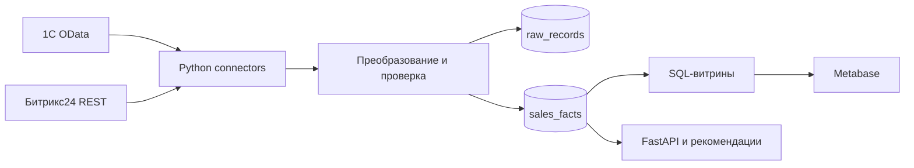

# Enterprise BI backend: первая итерация

Рабочий срез интеграционного слоя из аналитики проекта: заказы ERP и сделки CRM загружаются через HTTP, нормализуются и становятся доступны для отчётов. Для BI выбран Metabase как рабочая конфигурация прототипа. Система работает локально; внешние модели и облачные API аналитики не используются.

**Текущий стенд использует симуляторы протоколов 1С OData и Битрикс24 REST. Реальные продукты 1С и Битрикс24 здесь не установлены.** Коннекторы выполняют настоящие HTTP-запросы, но проверка совместимости с конкретной конфигурацией предприятия потребует её публикации, метаданных и доступов.

## Что реализовано

- Read-only адаптер 1С OData: Basic Auth, `$top`/`$skip`, сортировка по идентификатору, серверная пагинация в пределах того же endpoint.
- Адаптер классического REST Битрикс24 `crm.deal.list`: входящий webhook, `start`/`next`, проверка полноты по `total`.
- Настраиваемое соответствие исходных полей общей модели. Поля 1С зависят от конфигурации.
- Типизированная витрина `sales_facts`: источник, внешний ID, тип документа, сумма, валюта, статус, даты. Денежные значения в PostgreSQL имеют тип `NUMERIC(18,2)`; в JSON API суммы возвращаются строками.
- Полный снимок источника: повторная синхронизация заменяет его текущие записи, включая удалённые на стороне источника. Другие источники сохраняются. Это идемпотентная загрузка текущего состояния, не учёт событий продаж.
- Атомарная публикация: ошибка запроса, преобразования или записи не меняет предыдущую витрину.
- `sync_runs` с результатами и безопасными кодами ошибок. `raw_records` хранит успешные исходные снимки для последующего анализа. Десятичные JSON-числа сохраняются строками, чтобы не терять точность при разборе.
- Защита от одновременной записи одного источника: lease, продление между страницами, проверка токена перед публикацией, восстановление прерванных запусков.
- Ручной запуск через API и периодический worker.
- API ключ, разрешённые хосты источников, таймауты, ограничение размера ответа и числа записей, ограниченные повторы временных ошибок. HTTP-редиректы не выполняются.
- Две SQL-витрины для Metabase и правило рекомендаций по давно не изменявшимся открытым сделкам.
- Миграции Alembic, локальный Swagger UI, Docker Compose и тесты.

## Архитектура



`SourceConfig` описывает источник; `FieldMap` - соответствие полей. `Connector` читает страницы; `normalize` создаёт каноническую запись; `SyncService` публикует снимок в транзакции. Новая ERP/CRM добавляется отдельной реализацией чтения страниц с той же моделью результата.

## Быстрая проверка без Docker

Нужен Python 3.12+. Команды выполняются из корня этого каталога.

```powershell
py -3.12 -m venv .venv
.venv\Scripts\python -m pip install -r requirements.lock
.venv\Scripts\python -m pip install --no-deps --no-build-isolation -e .
.venv\Scripts\python -m pytest -q
.venv\Scripts\python scripts/check_demo.py
```

Последняя команда сама поднимает два локальных HTTP-сервера на свободных портах и временную SQLite БД, выполняет миграции, загружает 60 заказов и 125 сделок, повторяет загрузку и проверяет отсутствие дублей. В конце серверы останавливаются, временная БД удаляется. Бизнес-данные для проверки синтетические. SQLite предназначена для разработки; денежные и конкурентные сценарии на предприятии требуют PostgreSQL.

## Ручной локальный запуск

```powershell
.venv\Scripts\python scripts/configure_demo.py
.venv\Scripts\python -m alembic upgrade head
.venv\Scripts\python -m uvicorn bi_backend.demo_sources:app --host 127.0.0.1 --port 8010
```

Во втором терминале с тем же окружением и рабочим каталогом:

```powershell
.venv\Scripts\python -m uvicorn bi_backend.main:app_factory --factory --host 127.0.0.1 --port 8000
```

Swagger: http://127.0.0.1:8000/docs. В `Authorize` ввести `BI_API_KEY` из локального `.env`. Затем вызвать `POST /api/v1/sources/onec_demo/sync` и `POST /api/v1/sources/bitrix_demo/sync`. Автоматический опрос запускается отдельной командой `python -m bi_backend.worker`.

Генератор `.env` создаёт случайные пароли и API ключ и не перезаписывает существующий файл. Изменение паролей PostgreSQL после создания тома требует изменения ролей в БД; переписывание `.env` не меняет пароли уже созданных ролей.

## Docker: PostgreSQL + API + worker + Metabase

Нужен Docker Engine/Desktop с Linux containers и Compose v2. После установки Python-зависимостей:

```powershell
.venv\Scripts\python scripts/configure_demo.py
docker compose up --build -d
docker compose ps
```

Если `.env` уже создан предыдущим шагом, генератор повторно запускать не нужно.

Сервисы:

| Сервис | Назначение |
|---|---|
| `warehouse` | PostgreSQL, отдельные БД warehouse и metabase |
| `migrate` | Однократное применение миграций до старта API/worker |
| `demo-sources` | Симулятор API ERP/CRM с синтетическими данными |
| `api` | http://localhost:8000/docs |
| `worker` | Первичная загрузка и повторный опрос каждые 300 секунд |
| `metabase` | http://localhost:3000 |
| `gateway` | Nginx: вход на localhost:3000 и localhost:8000 |

API, Metabase, worker, база и симулятор подключены только к `internal: true` сети. Внутренние сервисы не публикуют порты напрямую: в Docker Desktop такой порт может остаться недоступным с Windows. Отдельный Nginx подключён к внутренней и входной bridge-сети и публикует только `127.0.0.1:3000` и `127.0.0.1:8000`. У прокси фиксированы два upstream: API и Metabase; произвольные адреса он не принимает. Внутренние сервисы не получают внешний маршрут через прокси.

На этом компьютере проверено: у API-контейнера отсутствует маршрут по умолчанию, внешнее TCP-подключение недоступно. Сам входной прокси имеет bridge-сеть; для полного air-gap ограничение внешнего доступа на целевом сервере и рабочем месте задаётся инфраструктурой. Загрузка Python-пакетов и Docker-образов выполняется **на этапе подготовки**, до переноса в закрытый контур. Нужно заранее собрать/экспортировать образы и перенести их вместе с конфигурацией. Изоляцию на целевой инфраструктуре следует проверить отдельно, включая браузер пользователя.

Настроены `MB_ANON_TRACKING_ENABLED=false`, `MB_CHECK_FOR_UPDATES=false`; телеметрия FastAPI отключена. Swagger JS/CSS поставляются внутри пакета, `validatorUrl` выключен. Визуализации Metabase с внешними картами, ссылками или изображениями потребуют отдельной настройки закрытого контура.

### Подключение Metabase

Для автоматической настройки демонстрационного стенда после готовности контейнеров выполнить:

```powershell
.venv\Scripts\python scripts/bootstrap_metabase.py
```

Скрипт создаёт локального demo-администратора, подключает витрины ролью `bi_reader` и создаёт дашборд с шестью блоками. Каждый SQL-запрос проверяется. Повторный запуск использует существующие объекты. Данные входа и API ключ сохраняются в `.local-access.json`; этот файл исключён из Git, Docker-контекста и выдаваемого ZIP-архива. Скрипт предназначен для синтетического стенда с 60 заказами и 125 сделками. Существующий чужой аккаунт без сохранённых локальных реквизитов он не перенастраивает.

При ручной настройке создать администратора через интерфейс и добавить PostgreSQL источник:

| Поле | Значение |
|---|---|
| Host | `warehouse` |
| Port | `5432` |
| Database | `warehouse` |
| Username | `bi_reader` |
| Password | `BI_READER_PASSWORD` из `.env` |
| SSL | выключен только для внутреннего демонстрационного соединения |

`bi_reader` получает только SELECT на `mart_sales_documents` и `mart_sales_summary`. Доступ к исходным снимкам, журналам и записи в БД ему не выдан. БД настроек Metabase использует другую роль и отдельную БД. Дополнительные SQL-примеры приведены в `examples/dashboard.sql`.

Первые графики: сумма заказов по месяцам; число сделок по стадиям; сумма открытых сделок по валютам. Заказ ERP и сделка CRM могут относиться к одной продаже, поэтому их нельзя суммировать как независимую выручку. Общий показатель выручки потребует связи документов и определения факта реализации/оплаты.

## Подключение настоящих 1С и Битрикс24

1. Скопировать `config/sources.real.example.yaml` в собственный файл. В `.env` указать его в `BI_SOURCES_FILE`.
2. Для 1С получить URL публикации стандартного OData-интерфейса, `$metadata`, список опубликованных документов и read-only пользователя. Проверить каждый реквизит в `fields`; имена в примере не гарантируются для конкретной конфигурации. `CurrencyCode` и `Status` в примере условные: часто потребуются соединения со справочниками или отдельный HTTP-сервис 1С.
3. Задать `ONEC_ODATA_URL`, `ONEC_USER`, `ONEC_PASSWORD` в окружении или `.env`. Часовой пояс наивных дат задаётся `source_timezone`. В БД даты хранятся в UTC без смещения, поля API следует интерпретировать как UTC.
4. Для Битрикс24 получить входящий webhook с правами чтения нужных сделок. Сохранить **полный** URL вида `https://crm.internal/rest/42/SECRET/` в `BITRIX_WEBHOOK_URL`. Коннектор обращается только к `crm.deal.list.json`. OAuth и REST 3.0 в этой итерации не реализованы.
5. Разрешить конкретные DNS-имена через `BI_ALLOWED_SOURCE_HOSTS`. Для Compose заменить конфигурацию `BI_SOURCES_FILE`, передать нужные переменные контейнерам API/worker и предоставить маршрут только к нужным внутренним системам. По умолчанию демонстрационная сеть до них не маршрутизируется.
6. Выполнить ручную синхронизацию и проверить `sync_runs`, количество документов и контрольные суммы с владельцем источника.

Учётные данные не записываются в `sync_runs` и не возвращаются в `/sources`. Исходные записи содержатся в закрытой таблице `raw_records`; политика хранения и очистки снимков пока не реализована. Отдельные организации используют отдельные развёртывания; многопользовательские роли и изоляция организаций ещё не реализованы.

## API

Все `/api/v1/*` принимают `X-API-Key`, если ключ задан. Пустой ключ допустим только для локальной разработки. `/health`, `/docs`, `/openapi.json` открыты.

| Метод | Путь | Результат |
|---|---|---|
| GET | `/api/v1/sources` | Источники и дата последней успешной загрузки |
| POST | `/api/v1/sources/{id}/sync` | Синхронная загрузка полного снимка |
| GET | `/api/v1/runs` | История запусков, фильтр `source_id`, limit/offset |
| GET | `/api/v1/runs/{id}` | Результат одного запуска |
| GET | `/api/v1/sales` | Записи с фильтрами source_id/currency/entity_type/status и пагинацией |
| GET | `/api/v1/analytics/summary` | Агрегаты по источнику, типу, валюте, статусу |
| GET | `/api/v1/recommendations` | Открытые сделки без изменений дольше `BI_STALE_DAYS` |

Синхронизация пока выполняется в процессе API либо worker. Это не очередь фоновых задач. Для крупных источников используйте worker; API-запрос может превысить таймаут reverse proxy. Лимиты по умолчанию: 10 000 записей, 5 МиБ на ответ, 50 МиБ на снимок. Пустой снимок запрещён; для намеренного удаления всех записей требуется `allow_empty_snapshot: true` в конфигурации источника.

## Рекомендации и следующие этапы

Текущее правило `stale_opportunity` прозрачно: сделка открыта, дата изменения известна, изменений нет больше 30 дней. Результат содержит причину, дни без обновления, сумму и валюту. **Это baseline на правилах; модель машинного обучения и прогноз продаж ещё не обучены.**

Дальнейшие задачи в порядке зависимостей:

1. Согласовать один реальный источник и проверенный маппинг. Если доступов не будет, поднять настоящую EspoCRM/Odoo отдельным сервисом и реализовать её адаптер. Симулятор протокола не заменяет этот этап.
2. Добавить справочники контрагентов/товаров, связи ERP/CRM и выбранную витрину предприятия; определить, что считается продажей, выручкой и закрытой сделкой.
3. Адаптировать демонстрационный дашборд Metabase и рекомендации к данным предприятия.
4. По объёмам выбрать инкрементальную загрузку с водяными знаками, повторы с отложенным запуском, очередь и карантин ошибок. Текущий pull-конвейер покрывает сбор и преобразование прототипа; полноценная двунаправленная ESB не реализована.
5. На исторических данных выбрать задачу ML, зафиксировать baseline, временное разделение train/test и метрику качества. Затем подключать scikit-learn и сохранять версии моделей/результатов.
6. Для использования людьми: SSO/RBAC, управление секретами, TLS, резервное копирование, мониторинг и очистка raw-снимков.

Постраничный полный экспорт не является согласованным снимком на стороне живого источника: записи могут меняться между запросами. Дубликаты и часть расхождений количества обнаруживаются, но строгая согласованность потребует экспорта/курсора, поддерживаемого конкретной системой.

## Проверки

`pytest -q` проверяет протоколы, типы, повторную загрузку, rollback после ошибки записи, блокировку источника, API ключ, пагинацию, SQL-витрины и рекомендации. `scripts/check_demo.py` проверяет цепочку по настоящему локальному HTTP.

Для запуска того же набора на PostgreSQL задать `BI_TEST_POSTGRES_URL` с **отдельной тестовой БД**: fixture применяет и откатывает миграции в этой БД. Workflow `.github/workflows/test.yaml` включён в репозиторий и проверяет Ruff, тесты на SQLite, HTTP-демонстрацию и тесты на PostgreSQL. [Первый запуск GitHub Actions](https://github.com/Lan1o/enterprise-bi-backend/actions/runs/45887270518) завершился успешно.

## Уточнения к исходной аналитике

Документ задаёт направление и варианты инструментов, а не окончательную спецификацию. Выбор Metabase/Python здесь - рабочее решение для первой итерации. NiFi, ClickHouse, scikit-learn и все перечисленные коммерческие аналоги одновременно не требуются для запуска этого среза.

Утверждение, что DataLens существует только как облачный сервис, неполно: есть [официальный open-source репозиторий с локальным запуском](https://github.com/datalens-tech/datalens). Это не меняет текущую конфигурацию Metabase, но сохраняет DataLens как вариант дальнейшего выбора.

Проверенные технические источники: [классический API сделок Битрикс24](https://apidocs.bitrix24.ru/api-reference/crm/deals/crm-deal-list.html), [Metabase в Docker](https://www.metabase.com/docs/latest/installation-and-operation/running-metabase-on-docker), [настройки Metabase](https://www.metabase.com/docs/latest/configuring-metabase/environment-variables), [локальные файлы Swagger в FastAPI](https://fastapi.tiangolo.com/how-to/custom-docs-ui-assets/), [руководство разработчика 1С, раздел стандартного OData](https://1c-dn.com/download-trial/files/guides/developer_guide.pdf).
